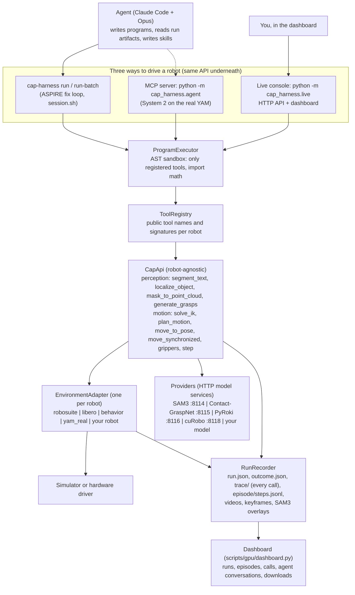

# The big picture: how ASPIRE's core works, and how to extend it to any robot

ASPIRE has an agent that writes small Python programs ("Code-as-Policy", CaP) against one
robot API. A harness runs those programs on a robot, simulated or physical, and records
everything they did. The agent then reads that record, debugs the program and keeps what
worked as reusable skills.

Every robot sits behind the same interface. Everything above that interface is
robot-agnostic: the agent, the sandbox, the robot API, the model services, the recorder and
the dashboard.

## The layers

| Layer | What it does | Code | Changes for a new robot? |
| --- | --- | --- | --- |
| Agent and pipeline | Writes programs, runs batches on development seeds, reads `trace/` and keyframes, fixes the program, validates on held-out seeds, distils skills | `.claude/skills/iterative-debugging/` | No. The skill library learns robot-specific tricks. |
| ProgramExecutor | Runs a program in an AST-checked sandbox. Only registered tools are callable; no imports except `math`; dunder and frame access blocked; step budget | `src/cap_harness/runtime.py` | No |
| ToolRegistry | The public tool namespace: shared names (`move_to_pose`, `segment_text`, ...) plus per-robot extensions (`robosuite.get_task_metadata`, `yam_real.*`) | `src/cap_harness/registry.py` | Add the robot's extension names |
| CapApi | Composes perception and motion from the adapter and providers: localize = segment + depth → point cloud; move = IK → plan → execute; grasp candidates from point clouds | `src/cap_harness/api.py` | No |
| EnvironmentAdapter | The only robot-specific code: reset, observe (cameras, RGB-D, intrinsics, poses), robot state, one control step, trajectory execution, grippers, success check | `src/cap_harness/{robosuite,libero,behavior,yam_real}/adapter.py`, contract in `protocols.py` | **Yes: write one** |
| Providers | Model services over HTTP, each in its own venv because the stacks conflict (torch vs JAX): SAM3 segmentation, Contact-GraspNet grasps, PyRoki IK (JAX), cuRobo IK and planning | `src/cap_harness/providers/*/{client,service}.py` | Kinematic model only (URDF for PyRoki, config for cuRobo) |
| RunRecorder | Writes an immutable run directory: every call with its inputs and outputs, step-by-step state, videos, keyframes, overlays, timing | `src/cap_harness/artifacts.py`, format in `docs/run-artifacts.md` | No |

## One call, end to end

`move_to_pose(target)` in a program:

1. **ProgramExecutor** checks the call against the registry. It records a `program` span and
   keyframes before and after the motion.
2. **CapApi.move_to_pose** records an `api` stage and calls `plan_motion`.
3. **IK:** the PyRoki provider is called over HTTP (`provider` span, inputs and outputs
   saved). cuRobo is used instead if the strategy asks for it.
4. **Planning:** the trajectory is interpolated, or planned collision-free by cuRobo.
5. **CapApi.execute_trajectory** sends the trajectory to the adapter.
6. **Adapter.step** runs once per control tick. The recorder logs each step's action, robot
   state and camera frames (`episode/steps.jsonl`, videos).
7. **The result** returns to the program: ok or error code, final joint error, and the final
   observation.

When the episode ends, `adapter.check_success()` decides `task_success` and `outcome.json`
is written. `session.sh why` and the dashboard read all of this back.

## Three ways to drive a robot

All three use the same CapApi, the same tools and the same recording.

| Mode | Use it for | Start it |
| --- | --- | --- |
| Batch | The ASPIRE loop, evaluations, `session.sh` | `cap-harness run` / `run-batch`, `scripts/gpu/session.sh run` |
| Live console | Exploring a robot by hand: see the cameras, call SAM3 or cuRobo, try motions and programs. Every call is recorded | `python -m cap_harness.live ...`, or the dashboard's *Live robots* page |
| MCP | An agent controlling a running robot step by step (System 2 on the real YAM) | `python -m cap_harness.agent` (`docs/system2.md`) |

The live console wraps the same `LiveAgentSession` that the MCP server uses: one job at a
time, with monitoring and events. It runs every job on the thread that created the
simulator, because MuJoCo's GL context belongs to that thread. Its HTTP API is listed in
`python -m cap_harness.live --help`.

## Adding a robot (simulated or physical)

1. **Adapter.** Implement `EnvironmentAdapter` from `src/cap_harness/protocols.py`:
   - `embodiment`, `reset(task_ref, seed)`, `get_task_context()`;
   - `get_observation()`: per camera RGB, depth in metres, intrinsics and camera pose, plus
     robot state;
   - `get_robot_state()`: joints, end-effector poses and grippers for every arm, and the base
     frame;
   - `step(action)`, `execute_trajectory(...)`, `set_gripper` / `set_grippers`, `close()`;
   - `check_success()` for benchmark tasks.

   Call `run_observer.on_reset / before_step / after_step` so the recorder sees every step.
   Copy the closest existing adapter: Robosuite for MuJoCo, YAM for real hardware with a
   motion gate. Time `execute_trajectory` to what your controller can follow: both simulators
   derive it from their gains (`trajectory_timing.controller_step_rad`), re-time every plan to
   it (`retime`) and settle while the arm still converges (`Settler`); see
   [harness-fixes.md](harness-fixes.md).
2. **Tasks.** Write a task registry (`resolve(suite, task_id)` → metadata with
   `suite_name`, `task_id`, `task_name`, language, horizon).
3. **Joint layout.** Add the embodiment's joints per arm to `JOINT_DIMENSIONS` in
   `contracts.py`. Register any extension tools under `<embodiment>.<name>`.
4. **Kinematics for IK and planning.** Either:
   - start a PyRoki instance with the robot's URDF (`--robot`, `--target-link`) on its own
     port, or
   - provide an in-process IK provider, as the YAM does with its MuJoCo-based IK.

   cuRobo is optional; it needs a robot config.
5. **Entry points.** Add the robot to:
   - `run_program` in `src/cap_harness/run.py`, for batch runs;
   - `build_robot` in `src/cap_harness/live.py`, for the live console;
   - `LIVE_VENVS` in `scripts/gpu/dashboard.py`, so the dashboard can start it.

   For hardware, keep the existing pattern: construction never moves the robot, and motion
   needs an explicit `--allow-motion`.
6. **Venv.** Put the simulator or driver in its own uv venv, like `.venv-robosuite`. The
   harness only talks to models over HTTP, so the model stacks never have to share it.

The agent, the skill library, the sandbox, the recorder and the dashboard work unchanged.
The agent learns robot-specific tricks into the skill library, not into the harness.

**A quadruped with an arm** needs one more capability: moving the base. That means base
state in `RobotState`, base-relative frames, and motion tools such as `move_base_to(pose)`
and `walk(velocity, duration)`. Add them as embodiment extensions first and promote them to
shared tools once a second mobile robot needs them. See
[review/roadmap-quadruped-arm.md](review/roadmap-quadruped-arm.md) for the staged plan
(simulation first).

## Adding a tool or model

To add a new segmenter, grasp model, planner or VLM:

1. Write a client that implements the matching protocol in `protocols.py`
   (`SegmentationProvider`, `GraspProvider`, `IKProvider`, `TrajectoryPlanningProvider`,
   `IntegratedPosePlanningProvider`). Add a new protocol if the capability is new.
2. Serve the model as an HTTP service in its own venv, with a port and a GPU in
   `configs/profiles/*.json`. `scripts/supervise_services.sh` and `scripts/gpu/services.sh`
   then start, health-check and stop it like the others.
3. Pass the client to `CapApi(...)`, wrapped in `TracedProvider(client, recorder, "name")`
   so every request is recorded. Expose it as a tool if programs should call it directly.

## Where to look

| You want to... | Look at |
| --- | --- |
| See what a run recorded | The dashboard, or `docs/run-artifacts.md` |
| Know why an episode failed | `scripts/gpu/session.sh why SESSION` |
| Read the robot API | `docs/api-reference.md` |
| Try a robot by hand | Dashboard → Live robots |
| Run the self-improving loop | `scripts/gpu/demo.sh campaign` and `.claude/skills/iterative-debugging/` |
| Compare two ideas, simulators or robots | Dashboard → tick runs → Compare, or `scripts/gpu/latency.py` |
| Add a dashboard page | `scripts/gpu/dashboard/static/views/` and `dashboard_store.py` |
| Check what was reviewed, fixed and planned | `docs/review/` |
