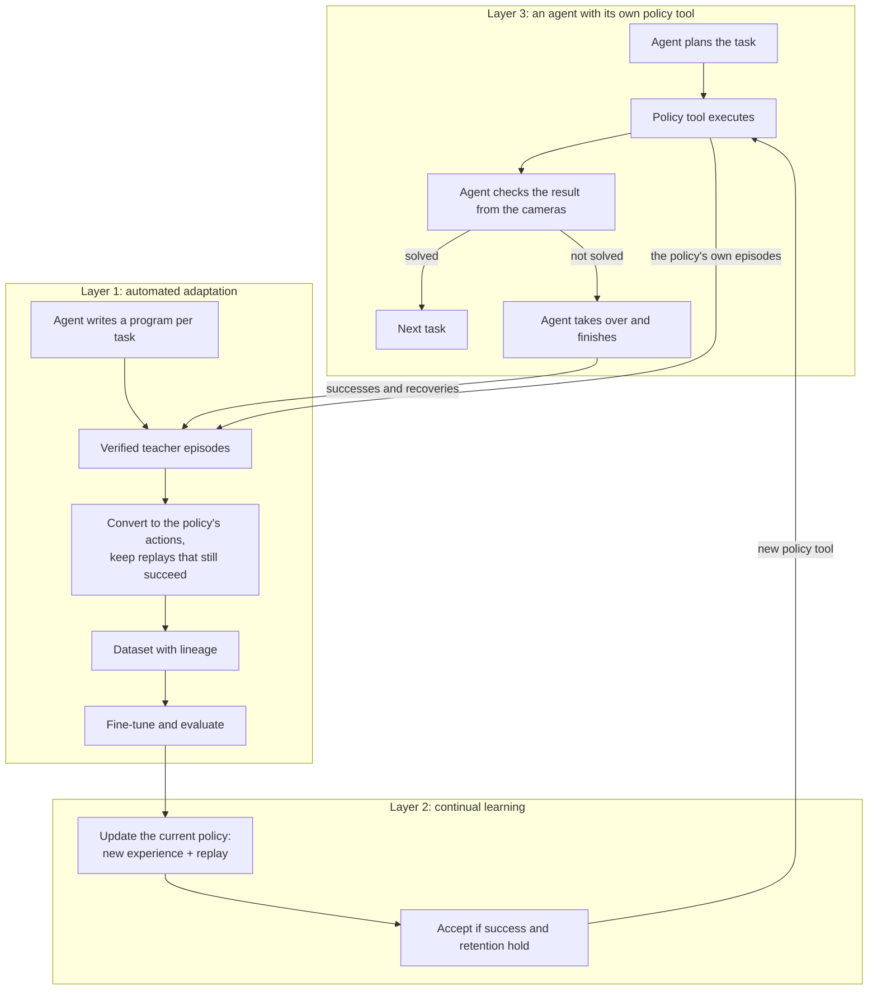

# Trace2VLA: three propositions

Trace2VLA is one system with three layers. Each layer is a proposition that stands on its own,
and each makes the next one possible. This page states each proposition, how it is realised in
this repository, the evidence so far, how to make it stronger, the experiments and figures that
carry it, and the work it builds on.

Back to the [project overview](trace2vla.md). The work list is in the
[roadmap](trace2vla-roadmap.md), the measurements in the [findings log](trace2vla-findings.md),
and the survey in [related work](trace2vla-related-work.md).

Last updated: 13 November 2026.

## The three layers at a glance

| Layer | Proposition | The question it answers | Headline measurement |
|---|---|---|---|
| **1. Automated adaptation** | An agent adapts a robot policy to a new task or environment with no human demonstrations | Can a policy be brought to a new environment automatically? | Success on scenes changed after training, and on layouts never trained on |
| **2. Continual learning** | One persistent policy learns task after task from the agent and keeps what it has learned | Can the same policy keep growing? | Success on every earlier task after every update |
| **3. An agent with its own policy tool** | The agent trains its own fast policy and hands it more of the work over time | Can the system keep the agent's success at a falling cost? | Share of the work done by the policy, cost per success, and success, over time |



Layer 1 is the engine: it turns the agent's experience into a trained policy. Layer 2 is the
update rule: it lets one policy keep learning. Layer 3 is the system: the agent uses the policy
it trained, and its own work becomes the next round of training data.

## Shared foundation

| | |
|---|---|
| Agent and teacher | NVIDIA ASPIRE [1] with Claude Opus 4.6: it writes a program per task that perceives through cameras (SAM3), plans and acts, and it debugs that program from recorded traces |
| Policy (student) | SmolVLA [2], 450M parameters, through LeRobot; π0.5 [13] as a second, larger policy |
| Benchmark | LIBERO [14] and LIBERO-Pro [9]: standard layouts, swapped layouts, and four more sibling layouts per task built in this repository |
| Pipeline | `scripts/gpu/t2v.sh`: `collect`, `prepare`, `dataset`, `train`, `eval`, `eval-steps`, `report`, with one ledger per experiment |
| Records | Every teacher and policy episode: steps, videos, tool calls, masks, labels, lineage and hashes |

Measured so far (tasks 0 and 1 of `libero_object_swap`, experiment `preflight2`, and the
ten-task baseline):

| Measurement | Result |
|---|---|
| SmolVLA before training, standard LIBERO-Object | 462 / 500 |
| SmolVLA before training, LIBERO-Pro object swap | 0 / 1,500 |
| Teacher on the 50 official swap scenes per task | 96 / 100 |
| Teacher on the training layouts | 98 / 100 |
| Teacher successes converted to the policy's control at 3× | 98 / 98, 162–216 steps (limit 280) |
| SmolVLA after fine-tuning on 77 teacher demonstrations (3,000 steps) | 0 / 100 → **86 / 100** on the official swap scenes |
| π0.5 before training on the same swap scenes | about 60% |

Numbers are given with numerators and denominators. Projections are marked as projections.

---

## Layer 1. Automated adaptation

### 1.1 The proposition

> **Given a new task or a changed environment, an agent brings a robot policy to it without any
> human demonstration.** The agent solves the task itself, records what it actually did, turns
> its verified successes into training data in the policy's own action format, fine-tunes the
> policy, and measures the result on scenes the policy has not seen.

The human gives the instruction. Everything after that is produced by the system: the solution,
the demonstrations, the dataset, the training run and the evaluation.

### 1.2 How it works in this repository

| Step | What happens | Where |
|---|---|---|
| Solve | The agent looks at the scene, checks its perception prompts, writes a program and debugs it on development scenes | `scripts/gpu/session.sh`, `scripts/gpu/prompts/llm_quick_demo.md` |
| Collect | The frozen program runs on named scene sets; every step, video, tool call and mask is recorded | `t2v.sh collect`, `src/cap_harness/trace2vla/teacher.py` |
| Verify | Each episode is replayed; its recorded outcome must reproduce | `t2v.sh teacher-grade`, `replay.py`, `src/cap_harness/vla/grading.py` |
| Convert | Each success is re-executed in the policy's control at 3× and kept only if the replay still solves the task | `t2v.sh convert`, `convert.py` |
| Build | A LeRobot dataset with a lineage manifest: each frame traces back to a teacher episode | `t2v.sh dataset`, `dataset.py` |
| Train | Full fine-tuning, LoRA, or LoRA including the vision-language backbone, with a checkpoint curve | `t2v.sh train`, `t2v.sh eval-steps`, `train.py` |
| Measure | The policy on the official scenes, the standard suite and the sibling layouts, with labelled outcomes | `t2v.sh eval`, `t2v.sh report`, `src/cap_harness/vla/benchmark.py` |

### 1.3 Evidence so far

* **The loop closes.** From an instruction to a fine-tuned policy with no human demonstration:
  teacher 96 / 100, conversion 98 / 98, policy 0 / 100 → 86 / 100 on the official swap scenes.
* **It is fast and cheap.** A teacher program costs \$4–7 of agent time, once per task.
  Collecting, converting, training and evaluating use no language model. SmolVLA trains in
  about 25 minutes per 3,000 steps.
* **Everything is traceable.** All 100 teacher episodes on the official scenes replay exactly,
  and every training frame is linked to the episode it came from.
* **The measurement is sharper than a single score.** Each policy episode is labelled with which
  object was lifted and which was placed, so the report separates *choosing the right object*
  from *manipulating it*.

### 1.4 What makes it strong

* **Verified executed trajectories.** The training data is what the robot really did, replayed
  and confirmed, not what a planner intended.
* **A camera-only teacher.** The teacher sees what a real robot would see, so the same recipe is
  meaningful outside the simulator.
* **The standard action format.** The policy keeps LIBERO's control interface, so published
  checkpoints are the starting point and results line up with other vision-language-action
  models.
* **A protocol that shows what was learned.** Evaluating on the changed layout, the original
  layout and layouts never used in training tells whether the policy learned to find the named
  object.

### 1.5 How to make it stronger

1. **Put the agent at the controls of the whole round.** One command that runs collect →
   dataset → train → evaluate, with the agent reading the report, choosing what to collect next
   and deciding whether to keep the new policy. `t2v.sh collect` already runs a full collection
   in one command; the round is the next step.
2. **Teach the policy where to look.** Train on several layouts per instruction, using the
   sibling layouts (`libero_object_swap_alt1…alt4`), so that the target appears in different
   places for the same words. Assign layouts so that every table position is a training position
   for some tasks and a held-out position for others, then test on the official swap, the
   standard layout and a held-out sibling.
3. **Use the whole trace as supervision.** The teacher's trace holds the mask it chose, the
   object's position and the sub-steps of its plan. Storing the teacher step behind each
   demonstration frame makes these available as extra training targets (point at the target,
   name the current sub-step), in the spirit of embodied chain-of-thought [15].
4. **Scale the evidence.** All ten tasks, both suites (`libero_object_swap`, then
   `libero_goal_swap`), both policies (SmolVLA and π0.5), three training seeds.
5. **Show the data curves.** Success against demonstrations per layout, and against the number
   of layouts at a fixed total.
6. **Check success from the agent's own cameras.** A success check built from the agent's
   perception, scored against the simulator on the thousands of labelled episodes already
   recorded. It is the piece that carries the method to a real robot.
7. **Open the real-robot path.** On the YAM station the teacher can act directly in the
   policy's action space and record the executed actions, so no re-execution is needed.
8. **Keep recoveries inside successes.** Episodes in which the program retried and then
   succeeded carry the recovery with them [12].
9. **Report cost.** Agent dollars per task, simulator seconds per demonstration, training time,
   and policy latency.

### 1.6 Experiments and figures

| # | Content |
|---|---|
| Table | Teacher, policy before, policy after, per task, on the same 50 official scenes |
| Table | Trained on sibling layouts: success on the official swap, the standard layout and a held-out sibling |
| Figure | Success against demonstrations per layout, and against number of layouts |
| Figure | Outcome labels before and after training: right object chosen, object placed |
| Table | Training method: full, LoRA, LoRA with the backbone; SmolVLA and π0.5 |
| Table | Cost per adapted task |

### 1.7 Work it builds on

* **ASPIRE** [1] supplies the agent, its execution engine and its traces.
* **Code as Policies** [16] and **Scaling Up and Distilling Down** [12] established language
  models writing robot programs and distilling their verified rollouts into policies.
* **SEAR** [3] runs an agent as a researcher that fine-tunes a policy on its own rollouts across
  330 tasks, and shows that more demonstrations bring the policy close to its code teacher.
* **SynthDemo-RL** [5] shows that synthesized demonstrations lift policies on LIBERO-Pro tasks
  that start at 0%.
* **LIBERO-Pro** [9] provides the changed layouts that make adaptation measurable.

**Our angle:** a camera-only agent teacher, demonstrations verified by replay in the policy's
own control, a compact 450M policy, and an evaluation that separates learning to find the object
from repeating a position.

---

## Layer 2. Continual learning

### 2.1 The proposition

> **One persistent policy learns task after task from the agent and keeps what it has learned.**
> Each round starts from the current policy, adds the agent's new experience to a replay of
> earlier experience, and is accepted only when success on the new task and on every earlier
> task holds.

```text
policy(k+1) = FineTune(policy(k), new verified experience + replay of earlier tasks)
accept policy(k+1) only if it passes the success and retention gate; otherwise keep policy(k)
```

The policy is never restarted. Its history is a chain of checkpoints, each with its parent, its
data and its evaluation.

### 2.2 How it works in this repository

| Piece | State |
|---|---|
| Start a training run from an earlier run | `t2v.sh train --base RUN` |
| Checkpoints during training, evaluated step by step | `--save-freq`, `t2v.sh eval-steps`, the dashboard's training curve |
| Development scenes for choosing a checkpoint | the `dev` scene sets |
| Retention measurement | every evaluation runs on the swap suite and on the standard suite |
| Outcome labels for both kinds of failure | `grading.py`: *another object* and *right object, not placed* |
| Simulator state at the start and end of every policy episode | stored with each episode, ready for takeover |
| Datasets from several sources | `t2v.sh dataset` with several demo sets; feature names match `lerobot/libero` for merging |

### 2.3 Evidence so far

* **The baseline that this layer improves is measured.** Updating the policy on the new layout
  alone raises the swap suite to 86 / 100, and the standard layouts fall from 89 / 100 to about
  0 within the first 500 steps. LoRA on the action expert behaves the same way. This is the
  reference point every continual method here is compared with.
* **The two kinds of failure are separable in practice.** Before training, 92 of 100 swap
  episodes placed another object in the basket; on the standard layouts all 11 failures had the
  right object. The labels that Layer 2 trains on already exist for every episode.
* **A larger policy starts from a different place.** π0.5 solves about 60% of the same swap
  scenes before any training, which gives the continual experiments a second starting point.

### 2.4 What makes it strong

* **Persistence.** One model accumulates skills, so later tasks start from everything learned
  before.
* **Experience from the policy's own states.** The agent can continue from where the policy got
  to, so the training data covers the situations the policy actually reaches.
* **Two corrective signals.** A wrong object and a failed manipulation are different mistakes
  and get different training data.
* **A gate.** No update is adopted unless it is at least as good as the policy it replaces.

### 2.5 How to make it stronger

1. **Replay.** Mix earlier experience into every update: the original LIBERO demonstrations and
   earlier rounds of teacher data. Replay is the most reliable retention method in recent
   studies [8].
2. **Self-rehearsal.** Add the current policy's own successful episodes on earlier tasks as
   replay, which needs no stored human data [4].
3. **The gate and the registry.** Each checkpoint records its parent, dataset, evaluation and
   the decision; the gate is evaluated on development scenes, in the manner of verified
   adoption [6].
4. **Start an episode from a saved state.** With it, the agent can take over from any point of
   a policy episode. Hand over at the failure, and also after a random number of policy steps,
   so that corrections cover the states the policy visits [11].
5. **Corrections for the wrong object.** Relabel the episode with what it really achieved [7],
   and add contrast demonstrations: the same scene with different requested objects.
6. **Corrections for a failed manipulation.** The agent's continuation from the policy's own
   state, in the tradition of interactive imitation [10, 17].
7. **Labels from the agent's own perception.** The agent names the outcome from the cameras; the
   simulator labels already stored score how accurate that is.
8. **A task sequence that spans skills.** The ten object tasks, then the goal suite (drawers,
   stove, rack), so that the sequence covers different manipulations.
9. **The standard comparisons.** One model trained on all tasks together as the upper bound, a
   fresh model per task, sequential training without replay (already measured), and an
   interactive-imitation baseline.
10. **Normalisation statistics as a setting.** Compare the checkpoint's statistics kept fixed
    with statistics recomputed on the mixed data [8].

### 2.6 Experiments and figures

| # | Content |
|---|---|
| Figure | Forgetting matrix: success on every earlier task after every update |
| Figure | Retention against replay amount, and self-rehearsal against stored replay |
| Table | Success-only, plus generic failure replay, plus manipulation corrections, plus wrong-object corrections, plus both, at matched data and steps |
| Table | Experience from resets against experience from the policy's own states |
| Figure | The chain of checkpoints with accepted and rejected updates |
| Table | Sequential student against the joint upper bound and the fresh-model-per-task baseline |

### 2.7 Work it builds on

* **LIBERO** [14] introduced lifelong robot learning as a benchmark.
* **RECALL** [8] shows that recovery data is more informative than data from task starts, and
  that replay keeps earlier skills.
* **Garg et al.** [4] retain earlier skills with the policy's own rollouts.
* **Probe, Learn, Distill** [11] collects corrections from the states the policy visits and
  distils them back by supervised learning.
* **Learning from Hindsight** [7] turns episodes that achieved a different goal into useful
  training signal.
* **Robo-COP** [6] adopts a new policy only after it is verified.
* **DAgger** [10] and **HG-DAgger** [17] are the foundation for learning from an expert's
  corrections.

**Our angle:** a persistent compact policy whose expert is a code-writing agent, with the two
kinds of failure treated by two different corrective signals, and retention measured after
every update.

---

## Layer 3. An agent with its own policy tool

### 3.1 The proposition

> **The agent and the policy are one system. The agent trains its own fast policy, uses it as a
> tool, and hands it more of the work as it improves.** The agent plans, the policy executes,
> the agent checks, and the agent steps in only when needed. Every success and every recovery
> becomes training data for the next version of the tool. The system keeps the agent's success
> while its cost falls.

The agent is not replaced. It becomes cheaper to run because it builds and maintains a tool
that does more of its routine work.

### 3.2 How the system runs

1. **Plan.** A task arrives. The agent reads the instruction and the scene and writes a plan.
   For a long task it breaks the plan into sub-tasks ("put the milk in the basket", then "put
   the butter in the basket").
2. **Delegate.** The policy tool executes the task, or one sub-task, for a step budget (for
   example 300 steps).
3. **Check.** The agent checks the result from the cameras: it localizes the named object and
   tests the relation the instruction asks for.
4. **Continue or take over.** If the step succeeded, the agent moves to the next sub-task. If it
   did not, the agent takes over from the current scene, finishes the step with its own
   program, and hands control back with the updated plan.
5. **Learn.** The policy's successes, the agent's takeovers and the agent's own solutions go
   into the experience store. Layer 1 turns them into training data; Layer 2 updates the tool
   and accepts the update through the gate.
6. **Remember when to delegate.** The agent keeps, in its skill library, which instructions and
   situations the tool handles well, and delegates accordingly.

The policy becomes a registered tool next to `move_to_pose` and `localize_object`: a call such
as `run_policy(instruction, max_steps)` that returns a typed result with its diagnostics, is
recorded in the trace like every other tool, and is available both to generated programs and to
the live agent over MCP.

### 3.3 What is measured

| Measure | Meaning |
|---|---|
| **Delegation rate** | Share of tasks (or steps) completed by the policy tool without the agent stepping in |
| **System success** | Success of agent plus tool, next to the agent alone and the tool alone |
| **Cost per success** | Language-model dollars, seconds per episode and GPU services, per solved task |
| **Agent involvement over time** | Programs written, takeovers and live turns per task, as the tool improves |

Costs already measured in this repository, per meter:

| Meter | Agent | Policy tool |
|---|---|---|
| Language model | \$4–7 to write and debug a program for a new task | none |
| Time per episode | 31–35 s on an idle machine | about 15 s in evaluation |
| Model services | SAM3, grasp planner, IK and motion planner | one model, about 3 GB for SmolVLA |

**Projection from numbers already measured** (to be confirmed by running the system): on the
official swap scenes of tasks 0 and 1 the trained policy solves 86 of 100 episodes. With the
agent taking the remaining 14 at its measured 96%, the system would solve about 99 of 100 with
86% of the episodes done by the policy.

### 3.4 What makes it strong

* **One system, not two.** The policy's improvement and the agent's usefulness are the same
  curve.
* **A high ceiling from the first day.** The agent can solve the task alone, so the system starts
  at the agent's success and only gets cheaper.
* **Data from real use.** Takeovers happen exactly where the tool needs help, so every round of
  use produces the most useful training data.
* **It compounds.** A better tool means fewer takeovers, more delegated tasks and more of the
  tool's own successes to rehearse.

### 3.5 How to make it stronger

1. **The success check.** Build it from the agent's perception tools and report its precision
   and recall against the simulator on the recorded episodes.
2. **Hand-over in the same scene.** Carry the scene from the policy's controller to the agent's
   and back, so a takeover continues the episode.
3. **Sub-task delegation on long tasks.** Multi-object and multi-step tasks (LIBERO-Long, several
   objects into one basket), where the agent's plan gives the tool one short instruction at a
   time. Layer 1's layout-diverse training gives the tool the instruction following this needs.
4. **A stream of new tasks.** Tasks arrive one after another; measure how many are solved by the
   tool without a new program, and how the agent's cost per task falls.
5. **The live agent as the reference.** In System 2 mode the agent acts step by step; the tool
   replaces long stretches of those steps, and the saving in agent turns is direct.
6. **Delegation as a learned skill.** Entries in the agent's skill library about when the tool
   is reliable, verified and promoted like every other skill.
7. **The real robot.** The same loop on the YAM station, where the agent already works through
   MCP and the cameras are the only source of truth.
8. **Two tools.** SmolVLA and π0.5 side by side, so the agent can choose the cheaper tool where
   it is enough.

### 3.6 Experiments and figures

| # | Content |
|---|---|
| Figure | Delegation rate over rounds, with system success on the same axis |
| Figure | Cost per success over rounds: agent alone, tool alone, agent with its tool |
| Table | Per task: agent alone, tool alone, system; takeovers and their outcomes |
| Figure | Long tasks: sub-tasks delegated and completed per plan |
| Table | The success check against the simulator: precision and recall |
| Figure | A stream of new tasks: programs written against tasks solved |

### 3.7 Work it builds on

* **Robo-COP** [6] co-evolves an orchestrator and a policy during deployment and verifies each
  new policy before adopting it.
* **SEAR** [3] runs agents with a policy in their toolbox and studies three ways for an agent to
  act: writing code, acting live, and training a policy.
* **Probe, Learn, Distill** [11] shows the value of an expert that takes over from the policy's
  own states.
* **ThriftyDAgger** [18] and **HG-DAgger** [17] study when an expert should step in and how to
  keep its effort low.
* **ASPIRE** [1] provides the skill library and the System 2 harness in which the tool lives.

**Our angle:** the orchestrator is a code-writing agent that can already solve the task alone,
the tool is a compact policy that the agent itself trains and keeps improving, and the result is
reported as cost at maintained success.

---

## How the layers reinforce one another

| | Gives | Receives |
|---|---|---|
| **Layer 1** | The engine that turns experience into a trained policy, and the test of what the policy learned | Experience from use (Layer 3) and the update rule (Layer 2) |
| **Layer 2** | A policy that keeps growing without losing skills | Verified data (Layer 1) and corrections from real use (Layer 3) |
| **Layer 3** | The reason for the other two: success at falling cost, and the most useful data | A tool that follows instructions (Layer 1) and stays reliable on earlier tasks (Layer 2) |

Each proposition can be presented alone, and together they form one statement: *an agent that
solves new manipulation tasks by itself and trains its own fast policy from that experience, so
that over time more of the work is done by the fast policy at the same success.*

## Order of work

| Step | Layer | Work | Roadmap |
|---|---|---|---|
| 1 | 1 | Ten tasks; training on sibling layouts; the three-way test (official swap, standard, held-out sibling); both policies | D |
| 2 | 1 | The round as one command, driven by the agent; the success check from the cameras | C |
| 3 | 2 | Replay and self-rehearsal; the gate and the checkpoint registry; the forgetting matrix | F |
| 4 | 2 | Start from a saved state; takeover data; the two corrective signals | E |
| 5 | 3 | The policy as a registered tool; delegate, check, take over; the delegation and cost curves | new |
| 6 | 3 | Long tasks with sub-task delegation; a stream of new tasks; the YAM station | new |

## References

| # | Paper |
|---|---|
| [1] | Lu et al. (2026). *ASPIRE: Agentic /Skills Discovery for Robotics.* [arXiv:2607.00272](https://arxiv.org/abs/2607.00272) |
| [2] | Shukor et al. (2025). *SmolVLA: A Vision-Language-Action Model for Affordable and Efficient Robotics.* [arXiv:2506.01844](https://arxiv.org/abs/2506.01844) |
| [3] | Wang et al. (2026). *SEAR: Self-Evolving Agentic Robotics.* [arXiv:2610.18792](https://arxiv.org/abs/2610.18792) |
| [4] | Garg et al. (2026). *Fine-Tuning VLAs with Self-Demonstrated Generative Control for Multi-Task Manipulation.* [arXiv:2608.19490](https://arxiv.org/abs/2608.19490) |
| [5] | Kingetsu et al. (2026). *SynthDemo-RL: Breaking the Zero-Reward Barrier in VLA Adaptation with LLM-Guided Synthetic Demonstrations.* [arXiv:2609.21650](https://arxiv.org/abs/2609.21650) |
| [6] | Zhang et al. (2026). *Co-Evolving Robot Orchestrators and Policies through Deployment (Robo-COP).* [arXiv:2610.09228](https://arxiv.org/abs/2610.09228) |
| [7] | Xu et al. (2026). *Learning from Hindsight for VLA Reinforcement Learning.* [arXiv:2607.09042](https://arxiv.org/abs/2607.09042) |
| [8] | Karli and Fitzgerald (2026). *RECALL: Recovery Experience Collection for Active Lifelong Learning in Vision-Language-Action Models.* [arXiv:2606.23617](https://arxiv.org/abs/2606.23617) |
| [9] | Zhou et al. (2025). *LIBERO-Pro: Towards Robust and Fair Evaluation of Vision-Language-Action Models Beyond Memorization.* [arXiv:2510.03827](https://arxiv.org/abs/2510.03827) |
| [10] | Ross et al. (2011). *A Reduction of Imitation Learning and Structured Prediction to No-Regret Online Learning (DAgger).* [arXiv:1011.0686](https://arxiv.org/abs/1011.0686) |
| [11] | Xiao et al. (2026). *Self-Improving Vision-Language-Action Models with Data Generation via Residual RL (Probe, Learn, Distill).* [arXiv:2511.00091](https://arxiv.org/abs/2511.00091) |
| [12] | Ha et al. (2023). *Scaling Up and Distilling Down: Language-Guided Robot Skill Acquisition.* [arXiv:2307.14535](https://arxiv.org/abs/2307.14535) |
| [13] | Physical Intelligence (2025). *π0.5: a Vision-Language-Action Model with Open-World Generalization.* [arXiv:2504.16054](https://arxiv.org/abs/2504.16054) |
| [14] | Liu et al. (2023). *LIBERO: Benchmarking Knowledge Transfer for Lifelong Robot Learning.* [arXiv:2306.03310](https://arxiv.org/abs/2306.03310) |
| [15] | Zawalski et al. (2024). *Robotic Control via Embodied Chain-of-Thought Reasoning.* [arXiv:2407.08693](https://arxiv.org/abs/2407.08693) |
| [16] | Liang et al. (2022). *Code as Policies: Language Model Programs for Embodied Control.* [arXiv:2209.07753](https://arxiv.org/abs/2209.07753) |
| [17] | Kelly et al. (2018). *HG-DAgger: Interactive Imitation Learning with Human Experts.* [arXiv:1810.02890](https://arxiv.org/abs/1810.02890) |
| [18] | Hoque et al. (2021). *ThriftyDAgger: Budget-Aware Novelty and Risk Gating for Interactive Imitation Learning.* [arXiv:2109.08273](https://arxiv.org/abs/2109.08273) |
