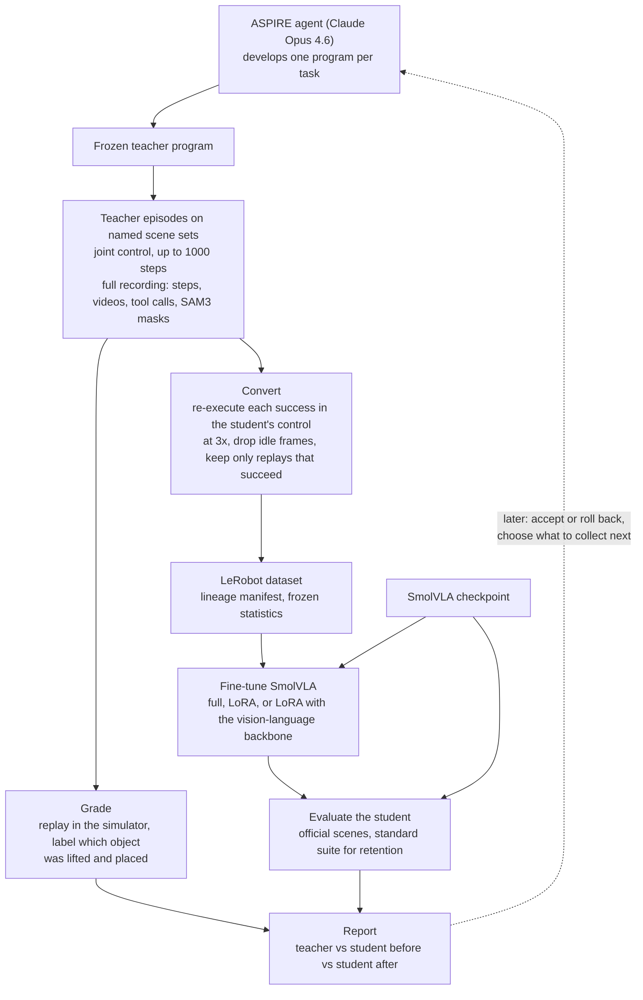

# Trace2VLA: project overview

**Trace2VLA: Distilling Agent-Executed Manipulation Trajectories into Compact
Vision-Language-Action Models.** This page says what the project is for, how it is built in this
repository, and where it stands. Start here; the other Trace2VLA documents go deeper on one
part each.

| Document | Read it for |
|---|---|
| **This page** | goal, design, status, results so far, glossary |
| [trace2vla-roadmap.md](trace2vla-roadmap.md) | what is left to do, the experiments for the paper, risks, open decisions |
| [trace2vla-findings.md](trace2vla-findings.md) | everything learned so far: what went wrong and why, what was fixed, what is open |
| [trace2vla-related-work.md](trace2vla-related-work.md) | the closest published work, what is already taken, what looks open |
| [trace2vla-review.md](trace2vla-review.md) | the measurements behind the design (11 November 2026) |
| [trace2vla-preflight.md](trace2vla-preflight.md) | every command of the first end-to-end pass |
| [vla-student.md](vla-student.md) | the student: setup, parity check, protocol, baseline |
| [harness-fixes.md](harness-fixes.md) | why teacher-agent runs failed and what was fixed |

Last updated: 12 November 2026.

## 1. The goal

An agentic system such as ASPIRE solves manipulation tasks by reasoning: a language model
writes a program that calls perception (SAM3), grasp planning, inverse kinematics and motion
planning, and repairs the program when it fails. It adapts well, and it is slow and costly to
run. A compact vision-language-action model (VLA) runs fast, and fails when the scene differs
from its training data.

**Research question.** Can a compact VLA acquire manipulation skills from a stronger agentic
controller by learning from its *verified executed trajectories*, and then improve after each
task without losing earlier skills?

| Role | System | Notes |
|---|---|---|
| Teacher | NVIDIA ASPIRE with Claude Opus 4.6 | one program per task, developed by the agent, then frozen |
| Student | SmolVLA (450M parameters) through LeRobot v0.4.4 | checkpoint `lerobot/smolvla_libero` |
| Second student | π0.5 (about 3.6B) through LeRobot v0.4.4, for comparison | checkpoint `lerobot/pi05_libero_finetuned_v044`; `--student pi05` ([vla-student.md](vla-student.md#two-students-smolvla-and-π05)) |
| Benchmark | LIBERO-Pro, first suite `libero_object_swap` | the target object changes places with another object |

**Hypotheses** (from the proposal):

* **H1.** Repeated success-only teacher demonstrations improve the student's autonomous
  success with fewer demonstrations than a conventional fixed-data baseline.
* **H2.** Separating *physical* failures (right object, failed manipulation) from *semantic*
  failures (wrong object) gives better targeted training than generic failure replay.
* **H3.** Replay and selective student experience preserve skills as one model learns tasks one
  after another.

These are questions, not findings. A neutral or negative result is reported as it is.

**Why this benchmark is a good test.** On `libero_object_swap` the student scores 0 of 1,500
episodes, and it fails in an informative way: it goes to where the object used to be. The paper
reports the teacher at about 98% on the same suite. The whole gap is about *which object*, which
is what the teacher's perception gets right.

## 2. Milestones

| | Scope | Completion gate | Status |
|---|---|---|---|
| **M0** Foundation | Teacher and student baselines in the same simulator; the bridge from teacher episodes to student training data; an archive of every episode with labels | One verified teacher success exported without time or action ambiguity; measured baseline table | **Done for two tasks** (teacher 96 / 100, student 0 / 100 on the same scenes). Eight tasks have no teacher program yet |
| **M1** Success only | Train the student on verified teacher successes; before and after on the same scenes; demo-count sweep; retention | First complete train → evaluate cycle; a learning curve | **In progress** ([preflight](trace2vla-preflight.md)): teacher data collected (98 / 100 on training layouts) and converted; dataset and fine-tuning next |
| **M2** Failure aware | Use labelled failures: teacher corrections for physical failures, relabelling and contrasts for semantic ones | An ablation showing whether targeted corrections beat success-only and generic replay | Labels exist. Training with them is not started |
| **M3** Continual | One persistent student across a sequence of tasks, with retesting of old tasks | Retention and sample-efficiency curves across skills | Not started. The pipeline is built so a loop can call it |
| **M4** Optional | The agent proposes tasks; the student steers what to collect; on-device updates | Benefit under matched budgets | Not started |

The critical path is M0 → M1. M2 follows. M3 and M4 strengthen a paper and do not block first
results. [trace2vla-roadmap.md](trace2vla-roadmap.md) has the detailed work list.

## 3. How it works

Design decisions, each with the reason. The measurements are in
[trace2vla-review.md](trace2vla-review.md).

| Decision | Reason |
|---|---|
| **The teacher is left exactly as published** (joint-position control, up to 1,000 steps) | ASPIRE's numbers stay comparable to its paper |
| **Teacher successes are converted afterwards by re-execution** in the student's hand-movement control (`OSC_POSE`), following the recorded hand path, and kept only if the replay still solves the task | The student keeps the standard LIBERO action format, so published checkpoints are the baseline and results compare with other VLAs. 27 of 28 replays succeeded in the prototype |
| **Conversion runs at 3× speed and drops idle frames** | Teacher episodes take 466–534 steps; the student's limit is 280. At 3× they take 190–208 |
| **Both are scored on the same 50 official scenes per task** | ASPIRE's own held-out seeds are random layouts, not the official saved scenes |
| **Scenes are split by named scene set, not by seed** | The 50 scenes of a LIBERO task differ by 0–4 cm, so "another seed" is nearly the same scene |
| **The checkpoint's normalisation statistics stay fixed during fine-tuning** | LeRobot's trainer would otherwise replace them with the small dataset's and rescale the model's inputs and outputs |
| **Simulator state is used for replay and grading only** | It is privileged. It never reaches the teacher agent or the student's inputs |
| **One experiment folder with a ledger** | Every stage appends what it produced, from what, with hashes, so any number can be traced to its episodes |
| **Each stage is one command** | A script runs a round today; later the agent can call the same commands (M3, M4) |

What the student learns from: at each step it sees two 256×256 camera images, the 8-number
robot state and the instruction, and its target is the chunk of actions the converted teacher
episode *actually executed* next. Later observations are stored for diagnosis and never used as
inputs.

## 4. Where things are in the repository

| Path | What |
|---|---|
| `src/cap_harness/vla/` | The student: SmolVLA or π0.5 through ASPIRE's simulator, benchmark runner, offline grader, parity check |
| `src/cap_harness/libero/layouts.py`, `configs/libero_layouts/` | Sibling layouts: each task's other LIBERO-Pro swap partners, as suites `libero_object_swap_alt1…alt4` |
| `src/cap_harness/trace2vla/checkpoints.py` | Where training checkpoints are kept (`t2v.sh checkpoints`): a bigger disk, linked from each run folder |
| `src/cap_harness/vla/students.py` | The two students: checkpoint, environment, camera names, training defaults, reference numbers; which student an old record belongs to |
| `scripts/bootstrap_pi05.sh` | Builds `.venv-pi05` for π0.5 (`vla.sh setup-pi05`) without touching SmolVLA's environment |
| `src/cap_harness/trace2vla/` | The pipeline: experiment store and ledger, scene sets, teacher stage, converter, dataset writer, trainer wrapper, report, command line |
| `src/cap_harness/libero/adapter.py` | The simulator adapter, with both control modes |
| `src/cap_harness/run_warnings.py` | Plain-language warnings read from a run's recorded calls |
| `scripts/gpu/vla.sh` | Student commands: setup, setup-pi05, parity, sanity, baseline, status, label-students |
| `scripts/gpu/t2v.sh` | Pipeline commands: init, check, teacher-add, teacher-run, teacher-grade, convert, dataset, train, eval, report, status |
| `scripts/gpu/session.sh`, `demo.sh` | Teacher development: the coding agent writes and debugs a task program |
| `scripts/gpu/dashboard.py` | Dashboard with the "VLA student" and "Trace2VLA" tabs |
| `scripts/experiments/trace2vla/` | The prototypes behind the design review |
| `third_party/lerobot` | LeRobot v0.4.4 (fork `hosseinhkh/lerobot`, branch `aspire-v0.4.4`) |
| `third_party/LIBERO-PRO` | The benchmark |
| `tests/test_vla.py`, `tests/test_trace2vla.py`, `tests/test_run_warnings.py`, `tests/test_students*.py`, `tests/test_label_students.py` | Tests |
| `outputs/vla/<run>/` | Student benchmark runs (not in git) |
| `outputs/trace2vla/<experiment>/` | One experiment: `teacher/`, `grades/`, `demos/`, `datasets/`, `training/`, `evals/`, `reports/`, `ledger.jsonl` (not in git) |
| `outputs/sessions/<time>-tasks/` | Recorded agent sessions (not in git) |

Everything runs in one repository and one environment (`.venv-libero`: Python 3.11,
torch 2.9.1, MuJoCo 3.3.0, robosuite 1.4.0), so the teacher and the student share the same
simulator build. The one exception is π0.5, which needs another `transformers`: it runs in
`.venv-pi05`, which has the same versions of everything else.

## 5. Results so far

All on the server "cali" (2× RTX PRO 6000 Blackwell). Numerator and denominator are always
given.

**Student (S0), before any training**

| Measurement | Result | Reference |
|---|---|---|
| Standard `libero_object`, 10 tasks × 50 scenes | 462 / 500 = 92.4% | SmolVLA paper: 96% |
| `libero_object_swap`, 10 tasks × 50 official scenes × 3 seeds | **0 / 1,500 = 0.0%** | not published before |
| Parity with LeRobot's own LIBERO environment | exact: images, robot state, simulator state and policy actions | |
| Actions executed per prediction | 10 of 50, chosen by measurement: 78% / 93% / 83% for 50 / 10 / 1 | |
| Before training, `preflight2`, tasks 0 and 1, official scenes | 0 / 100; 92 placed another object in the basket, 8 lifted another object | |
| The same two tasks on the standard layouts | 89 / 100 (42 / 50, 47 / 50); every failure had the right object | |
| How it fails (10 tasks, one episode each) | never lifted the requested object; 5 lifted another object, 4 of those placed it; 5 lifted nothing | [review §2.4](trace2vla-review.md) |

**Teacher (T0)**

| Measurement | Result |
|---|---|
| ASPIRE paper, `libero_object_swap` | about 98% (its own seeded layouts, not the official scenes) |
| Programs from session `20261112-033519` (tasks 0 and 1) | 3 / 3 development, 3 / 3 held-out, each task |
| Official scenes, earlier programs (12 November) | task 1: 41 / 50. Task 0: 0 / 34 (the program aimed at the wrong can and its grasp was out of reach) |
| Training layouts (seeded 1001–1050), current programs | task 0: 48 / 50, task 1: 50 / 50 |
| Official scenes, current programs (experiment `preflight2`) | **task 0: 46 / 50, task 1: 50 / 50** (96 / 100). All 100 episodes replay exactly; every success placed the requested object. Task 0's four failures all used a grasp suggested by the grasp planner and closed on nothing; the 46 that fell back to the program's own top-down grasp succeeded |

**Bridge (teacher episode → student demonstration)**

| Measurement | Result |
|---|---|
| Replays in the student's control that still solve the task | prototype 27 / 28; `preflight2` at 3×: **98 / 98** (48 of task 0, 50 of task 1) |
| Steps after conversion at 3× | task 0: 188–216 (teacher mean 537); task 1: 162–174 (teacher mean 420). Student limit 280 |
| Scene reproducibility | exact from (suite, task, mode, seed), in a freshly built environment only |
| End-to-end pipeline | verified on CPU with 6 recorded teacher episodes: grade, convert, dataset, train (three methods), evaluate, report |

**Not yet measured:** whether fine-tuning on teacher data raises the student's success (H1).
Training on the GPU. The converter on tasks other than 0 and 1.

## 6. Where the proposal changed

The proposal was written on 10 November 2026 before anything was run. These points changed
after a survey of related work and measurements in the simulator. Any write-up must state them.

| Proposal | Now | Why |
|---|---|---|
| Student baseline `lerobot/smolvla_base` | `lerobot/smolvla_libero` | The base model was pretrained on 6-joint SO-100 arms and cannot command a Panda. The proposal already names the LIBERO checkpoint as a "preadapted reference" |
| Convert the teacher's executed actions | Re-execute teacher successes in the student's control, keep verified replays | Teacher and student use different controllers and step limits |
| Train, dev and test split by seed | Split by named scene set; the main experiment holds out a *layout* | Seeds move objects by centimetres |
| 10 / 25 / 50 demonstrations per task | 25 / 50 / 100 / 200 | In SEAR, tasks with under 50 demos reached about 21% and those with 300 or more about 94%. Teacher demos cost only simulator time once the program works |
| LoRA fine-tuning | Compare default LoRA, LoRA covering the vision-language backbone, and full fine-tuning | The failure is in grounding, and LeRobot's default LoRA adapts only the action expert |
| M1 as a contribution | M1 is the baseline | Agent → VLA distillation and the adopt-or-revert gate are already published ([related work](trace2vla-related-work.md)) |
| Failure labels from the simulator | Labels for training should come from the agent's own perception; simulator labels are an oracle comparison | The "no privileged state" rule |
| First suite unspecified | `libero_object_swap` first | The teacher is strongest there and the student is at 0%, so the room to improve is largest |

## 7. Rules that hold throughout

* Simulation only. No real-robot execution.
* Simulator state is never shown to the student or to the teacher agent.
* ASPIRE's own run folders are never modified; the pipeline references them.
* Credentials are entered through hidden prompts and never stored in the repository or in logs.
* Test scenes are never used to debug a teacher program or to choose a training setting.
* Results are reported with numerators and denominators; comparisons with published numbers
  are not presented as head-to-head unless tasks, scenes and budgets match.

## 8. Glossary

| Term | Meaning |
|---|---|
| **Teacher program** | The Python program the ASPIRE agent wrote for one task (`program_best.py` or `fix_code.py`), frozen and registered in an experiment |
| **Teacher episode** | One run of a teacher program on one scene, with its full recording |
| **Demonstration (demo)** | A teacher success re-executed in the student's control and verified |
| **Scene** | One initial layout, fixed by (suite, task, init mode, seed) |
| **Scene set** | A named group of scenes with a role. `official`: saved scenes 1–50, test. `train`: seeded 1001–1050. `dev`: seeded 2001–2010 |
| **Saved / seeded** | Two ways LIBERO-Pro starts a scene: one of the 50 stored layouts, or a layout drawn from a seed |
| **Sibling layout** | The same task with a different swap partner; planned for the held-out-layout experiment |
| **Standard suite** | The original LIBERO suite (`libero_object`), used to measure retention |
| **Hand-movement control** | `OSC_POSE`: a 7-number action per step (change in hand position and angle, plus gripper) at 20 Hz. The student's control |
| **Joint control** | `JOINT_POSITION`: joint targets. The teacher's control |
| **Failure family** | `success`, `semantic` (another object, placed), `physical` (the requested object, not placed), `both`, `no_attempt` (the gripper never closed on an object), `unknown` |
| **Grade** | Offline labels for an episode, from replaying it with simulator state |
| **Ledger** | `ledger.jsonl` in an experiment folder: one event per stage run |
| **Retention** | The student's success on the standard suite after training on teacher data |
| **T0, S0, S1, S2, S3** | The proposal's experiment IDs: teacher reference; frozen student; student after success-only training; with replay; trained once offline on the same data |
| **Preflight** | The first complete pass on two tasks, to find problems cheaply before the ten-task run |
